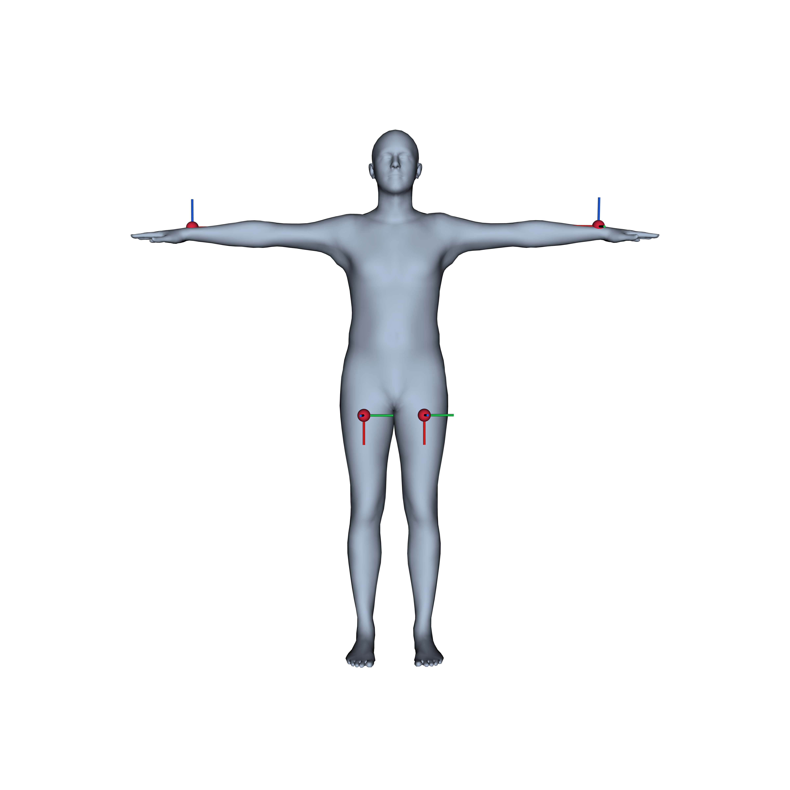
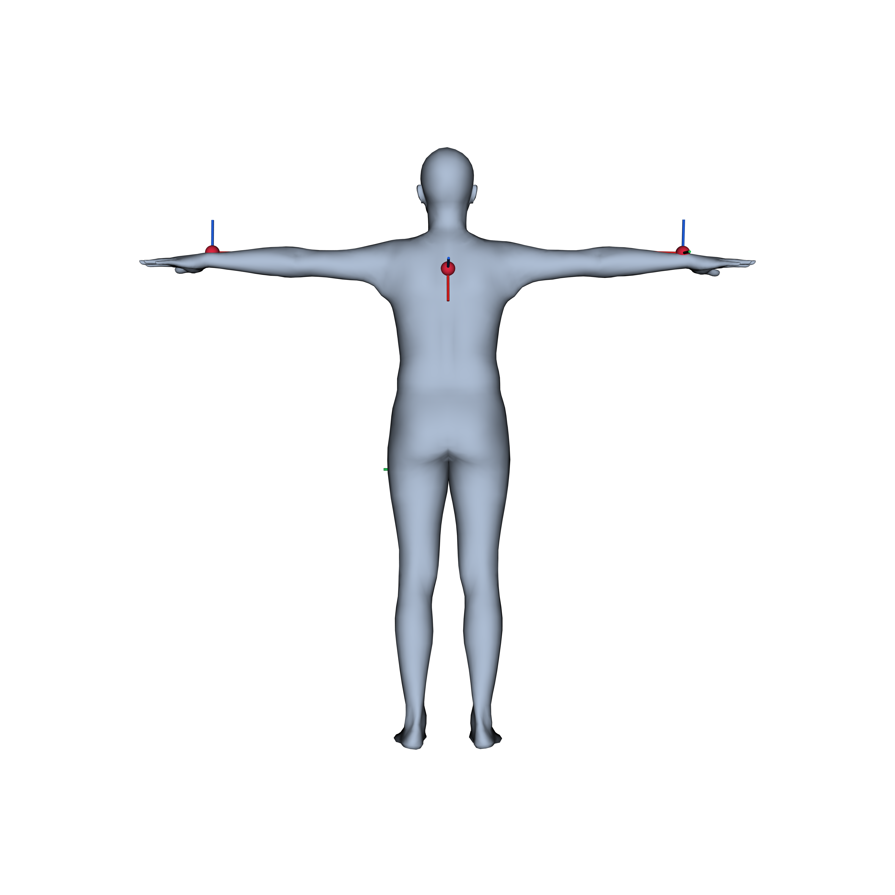

# SMPLy Reproducible

## Motivation

A persistent challenge in wearable sensing research is that sensor placement is rarely reproducible. Studies typically describe placement in natural language ("IMU attached to the dorsal side of the right wrist") which is often too ambiguous to reconstruct precisely across participants or labs. Even small differences in placement change the orientation of the sensor's local coordinate frame relative to the body, which directly affects accelerometer and gyroscope readings and makes cross-study comparisons difficult.

**SMPLy Reproducible** addresses this by using the [SMPL](https://smpl.is.tue.mpg.de/) parametric body model as an anatomical reference. Every sensor placement is stored as an exact vertex index on the SMPL mesh, a single integer that unambiguously encodes the position on a standardised 3D body. A YAML configuration file captures the full placement (position, sensor type, in-plane rotation, body shape parameters), making a setup shareable and recreatable by anyone. The same representation also makes it possible to correct for orientation mismatches or to deliberately introduce them as a form of data augmentation.

For a worked example of this tool applied on a real HAR dataset, see [`experiments/`](experiments/README.md).

<p align="center">
  
  
</p>
<p align="center"><em>Five example IMU placements, rendered by <code>tool/visualize.py</code>.</em></p>

---

## Setup

```bash
conda create -n smplyreproducible python=3.10
conda activate smplyreproducible
pip install -r requirements.txt
```

The SMPL model files (`tool/smpl/*.pkl`) are **not included** — download them from the [SMPL project page](https://smpl.is.tue.mpg.de/) and place them in the `tool/smpl/` directory.

All commands below are run from the repository root.

---

## Repository structure

```
SmplyReproducible/
├── tool/                           
│   ├── smpl_loader.py              # shared utilities: load SMPL model, apply betas, surface/orientation helpers
│   ├── pick_vertex.py              # step 0 (optional): click the body to find vertex indices
│   ├── place_sensors.py            # step 1: interactive click-to-place sensor tool
│   ├── place_sensors_via_vertex.py # step 1 (alt): place sensors at known vertex indices
│   ├── visualize.py                # step 2: static viewer / PDF export for a saved sensor placement YAML
│   ├── transform.py                # step 3: relative rotation matrix between two sensors
│   ├── verify_transform.ipynb      # standalone notebook verifying + visualizing transform.py's rotation math
│   ├── placements/                 # saved sensor placement YAMLs (default save/load location)
│   └── smpl/                       # SMPL model .pkl files — not tracked, download separately (see Setup)
├── experiments/                    # empirical validation on the RealWorld HAR dataset — see its own README
├── requirements.txt                # Python dependencies
├── LICENSE                         
├── .gitignore
└── README.md
```

---

## The files and their capabilities

All interactive 3-D windows below share
the same mouse navigation: left-click-drag to rotate the body, hold **Shift**
and drag to pan, hold **Cmd** (**Ctrl** on Windows/Linux) and drag to twist/roll
the view, scroll to zoom.

### `smpl_loader.py`
Shared utilities imported by all other scripts. Loads SMPL `.pkl` files and provides geometry helpers (`local_frame_from_normal`, `surface_pos_and_frame`) used to orient sensors on the body surface. Also holds the constants shared across the UI scripts (`VEDO_COLORS`, `AXIS_COLORS`, `CAMERAS`, `PLACEMENTS_DIR`, `DEFAULT_SMPL`, `DEFAULT_BETAS`).

### `pick_vertex.py` — find vertex indices
Interactive 3-D viewer: click anywhere on the body and the nearest vertex index, 3-D position, and local coordinate frame are shown in the window and printed to the console. Step 0 (optional) in the workflow — use this to look up `vertex_idx` values before running `place_sensors_via_vertex.py`.

```bash
python tool/pick_vertex.py
python tool/pick_vertex.py --smpl tool/smpl/your_model.pkl
python tool/pick_vertex.py --view front
```

Keyboard: `↑↓` opacity · `7/8` background · `q` quit.

### `place_sensors.py` — interactive click-to-place
Opens a 3-D body and lets you left-click to drop sensors directly on the surface. The vertex index of each placed sensor is printed to the console. Switch sensor type with `i/c/e/g` (IMU / Camera / EMG / PPG), adjust in-plane rotation with `h/j` (±10° around the surface normal), undo with `u`, and save to YAML with `s`. Step 1 in the workflow.

**Capability — exact placement documentation, placed interactively.** A sensor placement is a vertex index plus an in-plane orientation, not a natural-language description or a photograph, with live visual feedback as you place, rotate, and retype sensors before saving. Two people — or the same person on two different days — reproduce the identical placement from the resulting YAML alone.

| Flag | Default | Description |
|---|---|---|
| `output` (positional) | `tool/placements/sensors_placed.yaml` | Where to save the resulting YAML. |
| `--smpl SMPL` | bundled model | Path to an SMPL `.pkl` file. |
| `--view {front,back}` | free perspective | Starting camera view. |

```bash
python tool/place_sensors.py
python tool/place_sensors.py tool/placements/my_setup.yaml --view back
```

Keyboard: `i/c/e/g` sensor type · `h/j` rotate ±10° · `u` undo · `↑↓` opacity · `7/8` background · `s` save+quit · `q` quit.

### `place_sensors_via_vertex.py` — place by vertex index
Alternative, also step 1, placement tool for when you already know the vertex IDs (e.g. from `pick_vertex.py` or a vertex mask from a model). Pass them on the command line; sensors appear immediately so you can fine-tune orientation and type before saving — same exact-documentation capability as `place_sensors.py`, driven by known indices instead of clicks.

| Flag | Default | Description |
|---|---|---|
| `vertex_ids` (positional, 1+) | — | SMPL vertex indices to place sensors at. |
| `--output OUTPUT` | `tool/placements/sensors_placed.yaml` | Where to save the resulting YAML. |
| `--smpl SMPL` | bundled model | Path to an SMPL `.pkl` file. |
| `--view {front,back}` | free perspective | Starting camera view. |

```bash
python tool/place_sensors_via_vertex.py 1961 5424 876 4362 411 3021
python tool/place_sensors_via_vertex.py 2206 2235 --output tool/placements/my_setup.yaml --view front
```

Keyboard: click a sensor to select it (turns amber) · `h/j` rotate selected ±10° · `i/c/e/g` sensor type · `s` save+quit · `q` quit.

Both placement scripts write the same YAML format:

```yaml
smpl_path: smpl/basicmodel_neutral_lbs_10_207_0_v1.1.0.pkl
betas: [0, 1.5, 0, 0, 0, 0, 0, 0, 0, 0]   # SMPL shape parameters
sensors:
  - name: Imu_1
    type: imu
    vertex_idx: 2206
    position_3d: [0.72241, 0.25537, -0.05669]
    orientation:
      euler_xyz_deg: [0, 0, 30]
```

The `betas` field encodes the body shape used during placement. Including it in the config ensures that anyone reproducing the setup uses the same reference body. `smpl_path` is resolved relative to `tool/` regardless of where a script is invoked from.

#### How `orientation.euler_xyz_deg` is interpreted

Refer to the paper for more details.
`euler_xyz_deg` is **not** an absolute orientation — it's a twist applied *on top of* a frame the SMPL mesh already determines for you at `vertex_idx`. Two things compose to produce a sensor's final orientation:

1. **The SMPL-determined local frame (`R_local`).** `vertex_idx` fixes both the sensor's position *and* its surface normal — the direction pointing straight out of the skin at that point. `smpl_loader.local_frame_from_normal()` builds a right-handed frame from that normal alone: Z = the outward normal, X = the "most-upward" direction that still lies flat in the tangent plane, Y = Z × X. This is the frame you get with `euler_xyz_deg: [0, 0, 0]` — sensor lying flat on the skin, no rotation applied. This frame is automatically set with the choice of a sensor location.
2. **Your in-plane twist (`R_user`).** `euler_xyz_deg` is converted to a rotation matrix (`scipy.spatial.transform.Rotation.from_euler("xyz", ..., degrees=True)`) and composed as `R_local @ R_user`. In practice only the Z component is ever non-zero (that's what the `h`/`j` rotate keys control, ±10° per press) — a pure rotation about the surface normal. This spins the sensor's in-plane axes (X, Y) around however you like while leaving the Z axis — the surface normal itself — completely unchanged, so the sensor always stays flat against the skin at the exact point you picked.

In short: **where** you click determines the normal (and therefore two of the three orientation degrees of freedom for free); `euler_xyz_deg` only ever controls the remaining one — how the sensor is twisted around that normal. This is also precisely the $R_{S \leftarrow A}$ (sensor-to-segment orientation) used by `transform.py` to compute the relative rotation between two placements. If the sensor frame is not supposed to have one axis that is aligned with the skin normal, this has to be added.

### `visualize.py` — review a placement, or export it
Renders the SMPL body with all sensors from a YAML file. Sensors can be specified by `vertex_idx`, `position_3d`, or a named SMPL joint (`location: right_wrist`). Step 2 in the workflow.

**Capability — visualization**, either interactively or rendered offscreen straight to PDF/PNG (`--save-pdf`) for use in a paper or slide deck, no window required.

| Flag | Default | Description |
|---|---|---|
| `config` (positional) | `tool/placements/sensors_placed.yaml` | Sensor placement YAML to load. |
| `--view {front,back}` | free perspective | Camera view (interactive mode only). |
| `--save-pdf` | off | Skip the interactive window; render front+back offscreen and save each to PDF (and PNG). |
| `--output-dir OUTPUT_DIR` | `.` | Directory to save PDFs/PNGs into; used with `--save-pdf`. |

```bash
python tool/visualize.py
python tool/visualize.py tool/placements/my_setup.yaml --view front
python tool/visualize.py tool/placements/my_setup.yaml --save-pdf --output-dir figures/
```

Keyboard (interactive mode only): `↑↓` opacity · `7/8` background · `q` quit.

### `transform.py` — compute relative rotation
Given a sensor placement YAML, computes the rotation **R** between any two sensors such that:

```
x_in_A_frame = R @ x_in_B_frame
```

Apply **R** to raw IMU measurements from sensor B (accelerometer or gyroscope) to express them as if the sensor had been mounted at position A. Valid only when both sensors are on the **same rigid body segment** (no joint between them). Find more details and limitations of this in the paper.

**Capability — rotation transform between two placements.** A closed-form rotation matrix, exact for gyroscope, exact for accelerometer when the two placements share the same position, approximate (small, bounded lever-arm residual) otherwise. Applying it directly to recorded accelerometer/gyroscope data re-expresses it as if it had been recorded at a different placement — usable either as a post-hoc orientation correction, or, applied in reverse to a single recording at variable synthetic placements, as a form of data augmentation. See [`experiments/`](experiments/README.md).  
Another proposed application of this transformation is using the same transform for cross-dataset alignment (reconciling two datasets recorded at different placements) or cross-model alignment (feeding a pretrained model data from a placement it wasn't trained on). The underlying math is the same as the validated same-segment case above.

| Flag | Default | Description |
|---|---|---|
| `config` (positional) | — | Sensor placement YAML. Required. |
| `sensor_a` (positional, int) | none | Index of reference sensor A. Omit both `sensor_a`/`sensor_b` for interactive mode (click A then B in the viewer). |
| `sensor_b` (positional, int) | none | Index of sensor B, to be transformed into A's frame. |

```bash
python tool/transform.py tool/placements/my_setup.yaml           # interactive
python tool/transform.py tool/placements/my_setup.yaml 0 1       # sensor 1 -> sensor 0
```

Outputs the rotation matrix, quaternion (both `w x y z` and `x y z w` conventions), Euler XYZ angles, and angular distance in degrees.

### `verify_transform.ipynb` — verify the rotation math
Self-contained notebook (no YAML or SMPL model needed) that places two virtual sensors at known orientations, plots their X/Y/Z axes in 3-D alongside the gravity vector, computes **R** the same way `transform.py` does, and confirms that `R @ a_B == a_A` for static, dynamic, and decomposed (gravity + linear) scenarios. Useful for building intuition about what the rotation actually does to sensor measurements.

```bash
jupyter notebook tool/verify_transform.ipynb
```

---

## Typical workflow

1. **Find vertex IDs** (optional): `python tool/pick_vertex.py` → note the printed indices
2. **Place sensors**:
   - `python tool/place_sensors.py tool/placements/my_setup.yaml` — click on the body to place
   - `python tool/place_sensors_via_vertex.py 1961 5424 ... --output tool/placements/my_setup.yaml` — place at known indices
3. **Review**: `python tool/visualize.py tool/placements/my_setup.yaml` (or `--save-pdf` to export without a window)
4. **Get relative rotation**: `python tool/transform.py tool/placements/my_setup.yaml` → copy **R** into your processing pipeline
