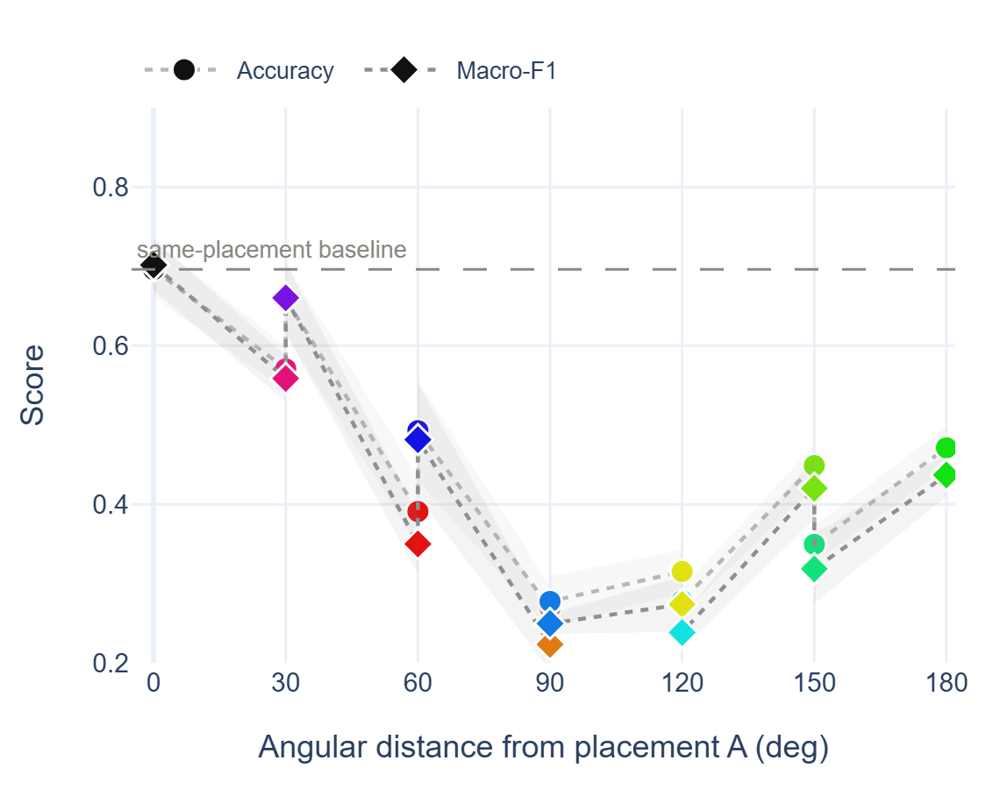
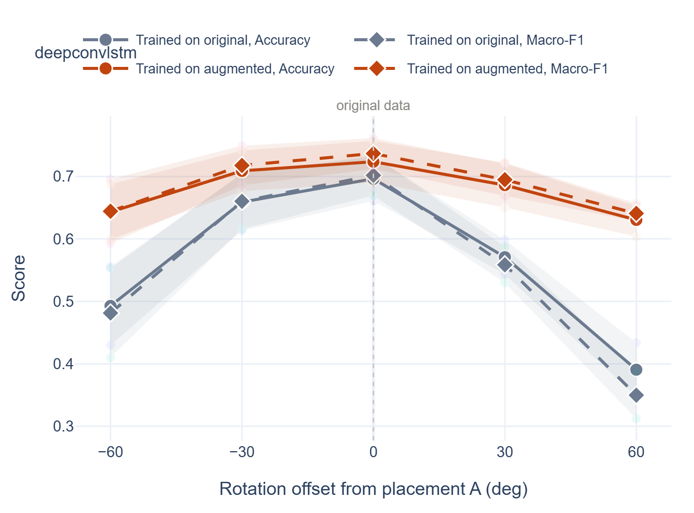

# experiments

Application of the `tool/` to the RealWorld (Sztyler) HAR dataset,
using accelerometer and gyroscope only: How much does sensor placement mismatch
degrade HAR performance, and how much is recovered by placement-mixed training.


## Structure

```
preprocessing/   windowing + labeling + CV-fold pipeline (raw zips -> windows.npz)
models/          HAR classifiers (LightGBM, DeepConvLSTM, TinyHAR, CNN-HAR)
scripts/         experiment orchestration, placement synthesis, figure generation
  experiment1_mismatch/     Experiment 1: does placement mismatch hurt performance
  experiment2_augmentation/ Experiment 2: does rotation-jittered training recover it
```

See `preprocessing/README.md` and `models/README.md` for details on those
stages. The breakdown of `scripts/` is below.

## Data processing

`preprocessing/` turns the raw RealWorld zip files into one windowed dataset:
acc+gyr are resampled onto a common time grid, cut into 3-second (150-sample,
50 Hz) windows, and labeled by activity and subject. Only the **forearm**
sensor is used -- the position all experiments below train and evaluate on.
The output (`windows.npz` + 5-fold leave-3-subjects-out `folds.json`) feeds
everything else in this folder.

## The two experiments

Both start from the same baseline (`scripts/baseline.py`):
train/evaluate each model at the single reference placement A (the real
forearm recordings), establishing the same-placement upper bound the other
two experiments compare against.

- **Experiment 1 -- does a placement mismatch degrade performance?**
  (`scripts/experiment1_mismatch/`) A model trained only on real placement A
  is evaluated, without retraining, on synthetic data rotated through a full
  orientation sweep around A's own location -- position is held fixed, only
  in-plane orientation varies -- using the SMPL-derived rotation from `tool/`.
  Answers whether mismatch hurts at all, and whether the penalty scales with
  angular distance from A. See
  [`../figures/transform_example.png`](../figures/transform_example.png)
  for an example: real A's raw accelerometer/gyroscope signal vs. the same
  motion synthesized at a target placement (`scripts/placement_transform_preview.ipynb`).

  <p align="center">
    
  </p>
  <p align="center"><em>
  DeepConvLSTM's headline result: accuracy drops as angular distance from A
  grows. See <code>scripts/plots/</code> for the other models. A different
  vertex (position changing alongside orientation) told a similar story. This
  same-vertex sweep is shown here since it isolates orientation cleanly and
  covers a full, continuous range of angular distances.
  </em></p>

- **Experiment 2 -- does placement-mixed/augmented training recover it?**
  (`scripts/experiment2_augmentation/`) Models are trained on real A plus
  rotation-jittered synthetic copies, then evaluated at the same offsets as
  Experiment 1. Tests whether exposing the model to placement variation during
  training closes the gap Experiment 1 found.

  <p align="center">
    
  </p>
  <p align="center"><em>
  DeepConvLSTM, trained with rotation-jittered copies, recovers most of
  Experiment 1's drop at the held-out offsets. See <code>scripts/plots/</code>
  for the other models.
  </em></p>

File by file:

**Shared (`scripts/`):**
- `baseline.py` — train/evaluate each model at the reference
  placement A, establishing the same-placement upper bound.
- `synthesize_placements.py` — shared utility: computes the SMPL-derived
  rotation between two placements and applies it to real placement-A data to
  synthesize a target placement's signal. Reads `placements/forearm_placements.yaml`.
- `dataset_utils.py` — shared in-memory-array dataset/scoring helpers
  (`ArrayWindowDataset`, `_subset`, `_concat`, `_loader`, `_score`), used
  wherever real and synthetic windows need to be freely subset, combined,
  and evaluated together. Imported by `orientation_sweep.py` (Experiment 1)
  and `augmented_training.py` (Experiment 2).
- `placements/forearm_placements.yaml` — the five placement definitions (A–E).
- `placement_transform_preview.ipynb` — previews the raw synthesized signal
  for any placement in the YAML. General-purpose, not specific to either
  experiment.

**`experiment1_mismatch/`:**
- `orientation_sweep.py` / `orientation_sweep_lightgbm.py` — same-vertex,
  in-plane orientation sweep.
- `plot_dose_response_same_vertex.py` (`--model`) — the headline dose-response
  plot, one per model.
- `plot_rotation_frames_3d.py` — 3D visualization of the 12 sweep rotations.

**`experiment2_augmentation/`:**
- `augmented_training.py` — trains on real data plus rotation-jittered
  copies, compares against baseline at held-out offsets.
- `plot_augmented_vs_baseline.py` (`--model`, `--tag`) — plots that
  comparison. `--tag` is the filename suffix matching the results file
  to read.

## Reproducing the paper's results

All commands below are run from `experiments/`. Generated artifacts
(`models/checkpoints/`, `*/processed/`, `scripts/plots/`) are gitignored
(except `plots/`, which is just regenerated wholesale) -- running these
scripts regenerates everything locally.

### 1. Preprocessing

```bash
cd preprocessing
python build_dataset.py
cd ..
```
Writes `preprocessing/processed/windows.npz` + `folds.json` (forearm position
only, all 15 subjects, 5-fold leave-3-subjects-out).

### 2. Baseline

```bash
cd scripts
python baseline.py --output processed/experiment0_baseline_results.json
```
Trains/evaluates LightGBM, DeepConvLSTM, and TinyHAR at the reference
placement A. This is the same-placement upper bound every other result below
compares against (CNN-HAR is excluded from the default run for time reasons,
add `--models cnnhar` to include it).

### 3. Experiment 1 -- does a placement mismatch degrade performance?

Same-vertex orientation sweep (the headline result, both PyTorch models +
LightGBM). **The `--vertex 2208 --step-deg 30` overrides are required** --
`orientation_sweep.py`'s own defaults (`--vertex 1922`, 36 points) point at a
different vertex.

```bash
cd experiment1_mismatch
python orientation_sweep.py --model tinyhar      --vertex 2208 --step-deg 30 --output ../processed/orientation_sweep_tinyhar_v2208_A.json
python orientation_sweep.py --model deepconvlstm --vertex 2208 --step-deg 30 --output ../processed/orientation_sweep_deepconvlstm_v2208_A.json
python orientation_sweep_lightgbm.py --output ../processed/orientation_sweep_lightgbm_v2208_A.json   # defaults already match (vertex 2208, 12 points)

python plot_dose_response_same_vertex.py --model tinyhar
python plot_dose_response_same_vertex.py --model lightgbm
python plot_dose_response_same_vertex.py --model deepconvlstm
python plot_rotation_frames_3d.py   # 3D visualization of the 12 sweep rotations, no JSON dependency
cd ..
```

### 4. Experiment 2 -- does placement-mixed/augmented training recover it?

```bash
cd experiment2_augmentation
python augmented_training.py --model tinyhar --output ../processed/experiment2_augmented_tinyhar_30_60.json
python plot_augmented_vs_baseline.py --model tinyhar --tag 30_60
cd ..
```
`--model` also accepts `deepconvlstm` (use the matching `--output`
filename, e.g. `experiment2_augmented_deepconvlstm_30_60.json`, and
`--tag 30_60` when plotting).

The training/eval rotation offsets (default +-30/+-60 deg) are also
configurable via `--inner-deg`/`--outer-deg`, for the smaller-angle jitter
results:

```bash
python augmented_training.py --model tinyhar --inner-deg 20 --outer-deg 40 --output ../processed/experiment2_augmented_tinyhar_20_40.json
python plot_augmented_vs_baseline.py --model tinyhar --tag 20_40

python augmented_training.py --model tinyhar --inner-deg 5 --outer-deg 10 --output ../processed/experiment2_augmented_tinyhar_5_10.json
python plot_augmented_vs_baseline.py --model tinyhar --tag 5_10
```
`--tag` must always match the `--output` filename's own `{inner}_{outer}`
suffix, since that's literally how the plot script finds the right file.

